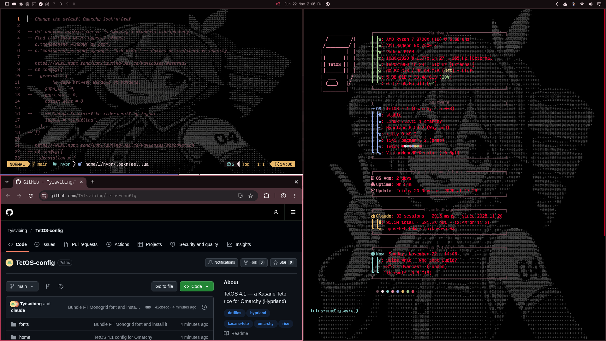

# Installing TetOS: a step-by-step guide for Linux beginners

This guide assumes you've never used Linux. Follow it top to bottom and you'll end up with this desktop:



**Time:** about 1–2 hours, mostly waiting for downloads.

---

## Contents

1. [A few words you'll see](#1-a-few-words-youll-see)
2. [Pick your path](#2-pick-your-path)
3. [Before you start (everyone)](#3-before-you-start-everyone)
4. [Path A: install Omarchy from a USB stick](#4-path-a-install-omarchy-from-a-usb-stick)
5. [Path C: add Omarchy to the Arch-based distro you already have (experimental)](#5-path-c-add-omarchy-to-the-arch-based-distro-you-already-have-experimental)
6. [Install TetOS (everyone)](#6-install-tetos-everyone)
7. [Using your new desktop](#7-using-your-new-desktop)
8. [Make it yours](#8-make-it-yours)
9. [Keeping it updated](#9-keeping-it-updated)
10. [Troubleshooting](#10-troubleshooting)
11. [Undoing things](#11-undoing-things)

---

## 1. A few words you'll see

| Word | What it means |
|---|---|
| **Linux** | An operating system, like Windows or macOS. It's free. |
| **Distro** | A "flavour" of Linux, ready to install. Arch, EndeavourOS, CachyOS and Omarchy are all distros. |
| **Arch-based** | A distro built on top of Arch Linux. They all install software with the same tool, `pacman`. |
| **Omarchy** | The Arch-based distro TetOS is built for. It comes with the Hyprland desktop, a top bar, menus and themes. |
| **TetOS** | This project: a Kasane Teto theme and set of settings that goes on top of Omarchy. |
| **Hyprland** | The program that draws your windows. Windows tile next to each other instead of overlapping. |
| **Terminal** | A window where you type commands. You'll copy and paste a few. |
| **Command** | One line you type into the terminal and run with **Enter**. |
| **`sudo`** | Put in front of a command to run it as administrator. It asks for **your** password. |
| **Package** | One installable program. `pacman` installs packages from the official servers. |
| **AUR** | A big collection of community packages. `yay` builds and installs them for you. |
| **ISO / USB installer** | A file you write to a USB stick so a PC can start from it and install Linux. |
| **BIOS / UEFI** | The settings screen built into your PC, before any operating system starts. |
| **Super key** | The Windows-logo key on your keyboard. Linux calls it Super. |

> **Typing passwords in the terminal:** nothing shows up while you type, not even dots. That's normal. Type it and press **Enter**.
>
> **Pasting in the terminal:** use **Ctrl + Shift + V** (plain Ctrl + V doesn't paste there).

---

## 2. Pick your path

| Your situation | Path |
|---|---|
| New to Linux, or happy to give a whole drive (or a whole PC) to Linux | **Path A** (recommended) |
| You already run **Omarchy** | Go straight to **[6. Install TetOS](#6-install-tetos-everyone)** |
| You already run another Arch-based distro (**Arch, EndeavourOS, CachyOS, Garuda**, ...) and want to keep it | **Path C** (experimental) |
| You run **Manjaro** | Not supported. Its packages lag behind Arch's, which breaks Omarchy. Use Path A. |
| You run Ubuntu, Mint, Fedora, ... | Not Arch-based, so this won't work. Use Path A. |

**Why is Path C "experimental"?** TetOS is a theme for Omarchy, and Omarchy officially installs only from its own USB installer. Path C uses a script from this repo that adds Omarchy's desktop to your existing distro. It is careful not to touch anything that controls how your PC starts. But it hasn't been run on every distro, so make a backup first.

---

## 3. Before you start (everyone)

1. **Back up anything you care about** (photos, documents, game saves) to an external drive or cloud storage. Installing an operating system can erase a drive if you pick the wrong one.
2. **Check your PC is 64-bit Intel or AMD.** Almost every PC from the last 10 years is. Apple Silicon Macs and ARM laptops are not covered by this guide.
3. **Have internet ready.** A network cable is easiest during install; Wi-Fi works too.
4. **Keeping Windows on the same PC (dual boot)?**
   - If your Windows drive uses **BitLocker** encryption, save your recovery key first: <https://aka.ms/myrecoverykey>. Changing boot settings can make Windows ask for it.
   - In Windows, turn off **Fast Startup**: Control Panel → Power Options → *Choose what the power buttons do* → *Change settings that are currently unavailable* → untick *Turn on fast startup*.
   - The safest setup for a beginner is a **second drive (SSD)** just for Linux. Then installing Linux never touches the Windows drive.

---

## 4. Path A: install Omarchy from a USB stick

You need a USB stick of **8 GB or more**. **Everything on the stick will be erased.**

### A1. Download Omarchy

Go to **<https://omarchy.org>**, find the **Install** section and download the ISO file (a few GB).

### A2. Write it to the USB stick

1. Download **balenaEtcher** from <https://etcher.balena.io> (works on Windows, macOS and Linux) and open it.
2. **Flash from file** → pick the Omarchy `.iso` you downloaded.
3. **Select target** → pick your USB stick. *Double-check it's the stick, not a hard drive.*
4. **Flash!** and wait until it says it's done.

> Rufus (Windows) works too. If it asks, choose **DD image mode**.

### A3. Start the PC from the USB stick

1. Plug the stick into the PC you're installing on, then restart it.
2. As soon as the screen turns on, tap the **boot menu key** over and over. It's usually:

   | Brand | Key |
   |---|---|
   | Dell, Lenovo, Acer, Gigabyte | **F12** |
   | HP | **F9** (or **Esc**, then F9) |
   | ASUS | **F8** (desktop) or **Esc** (laptop) |
   | MSI, ASRock | **F11** |

   Not sure? Search the web for "*your PC model* boot menu key".
3. In the menu, choose the entry with your USB stick's name. If there are two, pick the one starting with **UEFI**.

> **"Secure Boot violation"** or the stick doesn't show up? Go into the BIOS/UEFI settings (usually **F2** or **Del** right after power-on), turn **Secure Boot** off, save and try again.

### A4. Run the Omarchy installer

The installer walks you through a few questions. You'll be asked for things like:

- your **keyboard layout**
- your **name, username and password**: *write the password down*
- **which drive to install to**: *pick the empty/Linux drive, not your Windows or backup drive*
- a **disk encryption password**: you type it every time the PC starts. *Write it down too. If you lose it, the data can't be recovered.*

When it's done, remove the USB stick and restart. Omarchy's own manual has pictures of every screen if you get stuck: <https://learn.omacom.io/2/the-omarchy-manual>

### A5. First start

1. Type your **disk encryption password** and press Enter.
2. You land on the Omarchy desktop.
3. **Wi-Fi:** press **Super + Ctrl + N** (or click the network icon in the top bar) and pick your network.

Now go to **[6. Install TetOS](#6-install-tetos-everyone)**.

---

## 5. Path C: add Omarchy to the Arch-based distro you already have (experimental)

This keeps your current distro and adds Omarchy's desktop as a new option at the login screen.

**What the script changes:**
- adds Omarchy's package repository and installs Omarchy (about 160 packages, a few GB)
- copies Omarchy's default settings into your home folder (your old files are backed up first)
- sets up the SDDM login screen (it asks before replacing GDM, LightDM or another login screen)

**What it never touches:**
- your boot loader (GRUB, systemd-boot, Limine, rEFInd)
- your initramfs
- your distro's own repos and mirrors
- your distro's name

**What you don't get compared to a real Omarchy install:**
- the Limine snapshot boot menu
- the Plymouth boot splash
- Omarchy's disk-encryption login

### C1. Make a snapshot or backup

If your distro has **Timeshift** or **Snapper** (EndeavourOS, CachyOS and Garuda often do), the script offers to make a snapshot. Say yes. Otherwise, back up your home folder.

### C2. Open a terminal and update

Open your distro's terminal app and run:

```bash
sudo pacman -Syu
```

Type your password, press **Enter** to accept, and wait. If the kernel was updated, restart before going on.

### C3. Download TetOS

```bash
sudo pacman -S --needed git
git clone https://github.com/Tyisvibing/TetOS-config.git ~/TetOS-config
cd ~/TetOS-config
```

### C4. Run the bootstrap

```bash
./bootstrap/omarchy-layer.sh
```

- Don't put `sudo` in front. It asks for your password itself.
- It checks your PC, then shows exactly what it will do. Type **yes** to continue.
- The install takes 10–40 minutes depending on your internet.
- Everything it prints is also saved to `~/tetos-bootstrap.log`.

### C5. Restart into Omarchy

```bash
sudo reboot
```

At the login screen, open the **session** menu (on SDDM, the button in the bottom-left corner), pick **Omarchy (Hyprland uwsm)** and log in.

From now on you'll **update with `omarchy update`**. Omarchy blocks plain `sudo pacman -Syu` with a "Woah partner" message so updates go through its own steps.

Now continue with **6. Install TetOS** below. You already have the files, so skip the `git clone` line.

---

## 6. Install TetOS (everyone)

You should now be on the Omarchy desktop.

### 6.1 Open a terminal

Press **Super + Enter**. A terminal window opens.

### 6.2 Download TetOS

Copy each line, paste it with **Ctrl + Shift + V**, then press **Enter**:

```bash
git clone https://github.com/Tyisvibing/TetOS-config.git ~/TetOS-config
cd ~/TetOS-config
```

### 6.3 Run the installer

```bash
./install.sh
```

First it asks a few yes/no questions. Type `y` or `n` and press Enter (just Enter means **no**):

| Question | What it does | Suggestion |
|---|---|---|
| *Also install my other apps?* | VS Code, Steam, OBS, Opera, Spotify, ... ([full list](packages/apps.txt)) | Only if you want them |
| *Add Mango and IceWM as extra sessions?* | Two other desktops you can pick at the login screen, with the same shortcuts | Optional, for tinkerers |
| *Build my own apps: knobs and muse-tui?* | A config-file editor and a terminal music player (see the [README](README.md#my-apps)) | Optional |
| *Install the TetOS login screen?* | The retro TetOS login dialog | **Yes** (see [8.5](#85-see-the-tetos-login-screen)) |
| *Install the TetOS boot splash?* | TetOS logo while the PC starts. Only asked on real Omarchy | **Yes** |
| *Windows found: install the dual-boot helpers?* | Restarts come back to the system you were in, plus a "Restart to Windows" shortcut. Only asked if Windows is on the PC | Yes, if you dual-boot |
| *Install the 'outline draw' wallpaper transition?* | Prettier wallpaper changes, but a ~1 GB download | Your call. There's a simpler transition either way |

Then it works on its own:
1. It installs the packages TetOS needs (it may ask for your password).
2. It copies the settings. Any file it replaces is saved to `~/.local/state/tetos-backup-<date>/`.
3. It switches to the TetOS theme.

### 6.4 Log out and back in

Press **Super + Escape** → **Log out**, then log back in. You'll see the **"Welcome to Kasane Territory"** splash. Done! 🎉

> Want to run it again later (for example after updating)? `cd ~/TetOS-config && ./install.sh`. It's safe to re-run.

---

## 7. Using your new desktop

Press **Super + K** at any time to see **every** shortcut, with a search box.

### The basics (from Omarchy)

| Keys | What it does |
|---|---|
| **Super + Enter** | Terminal |
| **Super + Alt + Space** | App list |
| **Super + Space** | Omarchy menu (settings, install apps, themes, ...) |
| **Super + Escape** | Lock / log out / restart / shut down |
| **Super + W** or **Super + Q** | Close the window |
| **Super + 1 … 0** | Switch to workspace 1–10 |
| **Super + Shift + 1 … 0** | Move the window to workspace 1–10 |
| **Super + T** | Make a window float / tile again |
| **Super + Shift + Enter** | Web browser |
| **Super + Shift + F** | File manager |
| **Print Screen** | Screenshot |
| **Super + Ctrl + V** | Clipboard history |
| **Super + Ctrl + L** | Lock the screen |
| **Super + Ctrl + N** | Wi-Fi / network |

### Added by TetOS

| Keys | What it does |
|---|---|
| **Super + Ctrl + Space** / **Super + Ctrl + W** | Pick a wallpaper (with the TetOS transition) |
| **Ctrl + =** / **Ctrl + −** | Volume up / down (for keyboards without media keys) |
| **Ctrl + Shift + Esc** | Task manager (Mission Center) |
| **Super + Alt + M / H / U** | Control the mouse from the keyboard (warpd); **Super + Shift + Alt + K** lists its keys |
| **Super + Alt + A** | Claude Code in a terminal |
| **Super + Shift + D** | Discord |
| **Super + Alt + O** | Opera |
| **Super + Ctrl + C** | VS Code |
| **Super + Shift + M** | Muse music player |
| **Super + Alt + P** | Pulsar editor |
| **Super + Ctrl + Alt + ]** | Restart straight into Windows (dual-boot helpers only) |

Shortcuts for apps you didn't install simply do nothing.

**Fun extras:**
- Show the login splash again: `qs -c tetos-splash`
- Preview the lock screen: `omarchy-shell lock preview`
- System info with the TetOS logo: `fastfetch`

---

## 8. Make it yours

To edit a text file, open it in the terminal editor: `nvim <file>`. In nvim, press **i** to type, then **Esc**, type `:wq` and **Enter** to save and quit. Or use any text editor you like.

### 8.1 Weather location (in `fastfetch`)

Edit `~/.config/fastfetch/config.jsonc` and change `"location": "London"` to your town. Use `+` instead of spaces, e.g. `New+York`.

### 8.2 Clocks in the top bar

Edit `~/.config/omarchy/shell.json`, find `"cities"` and change the names and time zones (`"zone": "Europe/Paris"` style; [list of zones](https://en.wikipedia.org/wiki/List_of_tz_database_time_zones)). The bar updates when you save.

### 8.3 Screens / monitors

TetOS does **not** change your monitor settings (mine are for two very specific screens). To adjust yours, run `hyprctl monitors` to see their names, then edit `~/.config/hypr/monitors.lua`. The file has examples in it.

### 8.4 Wallpapers

**Super + Ctrl + Space** picks a wallpaper. To add your own, put images in `~/.config/omarchy/backgrounds/tetos/` (`omarchy theme bg install` opens that folder for you).

### 8.5 See the TetOS login screen

Omarchy logs you in automatically after the disk-encryption password, so you never see the login screen. To turn automatic login off:

```bash
grep -l '^User=' /etc/sddm.conf.d/*          # shows the autologin file, e.g. /etc/sddm.conf.d/autologin.conf
sudo mkdir -p /etc/sddm.conf.disabled
sudo mv /etc/sddm.conf.d/autologin.conf /etc/sddm.conf.disabled/   # use the name the first line printed
```

Move the file back to turn autologin on again. (It has to leave the folder completely: SDDM reads every file in `sddm.conf.d`, whatever its name.)

### 8.6 Another theme

**Super + Ctrl + T** opens the theme picker. Choose **Tetos** to come back.

---

## 9. Keeping it updated

- **System + Omarchy:** run `omarchy update` (or Super + Space → Update). Do this every week or two.
- **TetOS:**
  ```bash
  cd ~/TetOS-config
  git pull
  ./install.sh --minimal
  ```

---

## 10. Troubleshooting

**"Woah partner... This looks like a direct pacman system upgrade."**
That's Omarchy asking you to use `omarchy update` instead of `sudo pacman -Syu`. Installing single packages with `sudo pacman -S <name>` is fine.

**The screen is black / frozen after logging in.**
Press **Ctrl + Alt + F3** to get a text login. Log in, then undo TetOS's look: `omarchy theme list` shows the theme names, `omarchy theme set <name>` switches, and `omarchy refresh shell` resets the bar and lock screen. Press **Ctrl + Alt + F1** (or F2) to go back to the graphical screen. Your old config files are in `~/.local/state/tetos-backup-<date>/`.

**An AUR package failed to build** (`ttf-chicagoflf`, `ttf-monaco`, ...).
AUR packages sometimes break for a day or two. Try again later with `yay -S <name>`. Missing fonts just make some text use a different font.

**No splash after logging in.**
Run `qs -c tetos-splash` in a terminal and read the error. Make sure `~/.config/hypr/autostart.lua` contains the `tetos-splash` line.

**Wallpaper changes have no animation.**
Use **Super + Ctrl + Space** (it goes through the transition). Check the effect is running: `qs -c wallfx ipc call wallfx state`.

**Path C: my shell is fish (CachyOS) and some terminal shortcuts are missing.**
Omarchy's terminal setup is written for bash. Switch your login shell with `chsh -s /bin/bash`, then log out and in.

**Path C: NVIDIA graphics card.**
Keep your distro's NVIDIA driver (the bootstrap leaves drivers alone). Hyprland needs the official NVIDIA driver, not the open-source `nouveau` one.

**Still stuck?** Open an issue on this repo and paste the error. For Path C, attach `~/tetos-bootstrap.log`.

---

## 11. Undoing things

**Go back to stock Omarchy's look:**
```bash
omarchy theme list                     # see the theme names
omarchy theme set <another theme>
omarchy refresh shell                  # stock bar + lock screen (it backs up first)
sudo ./sddm/install.sh --revert        # stock login screen
sudo plymouth-set-default-theme -R omarchy   # stock boot splash (real Omarchy only)
sudo systemctl disable boot-order-linux-first   # dual-boot service
```
Old copies of every file TetOS replaced are in `~/.local/state/tetos-backup-<date>/`.

**Undo the Path C bootstrap** (removes Omarchy's desktop from your distro):
```bash
sudo systemctl disable sddm && sudo systemctl enable <your old login manager, e.g. gdm or lightdm>
sudo pacman -Rns omarchy omarchy-settings tetos-boot-shim
sudo cp /etc/pacman.conf.pre-tetos /etc/pacman.conf
sudo /usr/local/lib/tetos/restore-etc
sudo rm -f /etc/pacman.d/hooks/zz-tetos-keep-distro-files.hook
sudo pacman -Syu
```
Your pre-bootstrap home-folder files are in `~/.local/state/tetos-bootstrap-backup-<date>/`. If you made a Timeshift/Snapper snapshot in step C1, restoring it is the cleanest way back.
