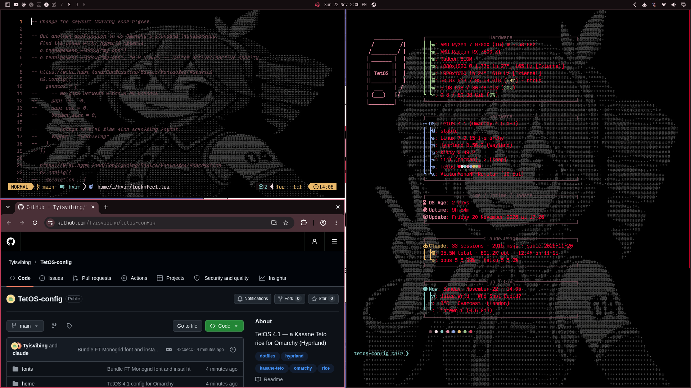
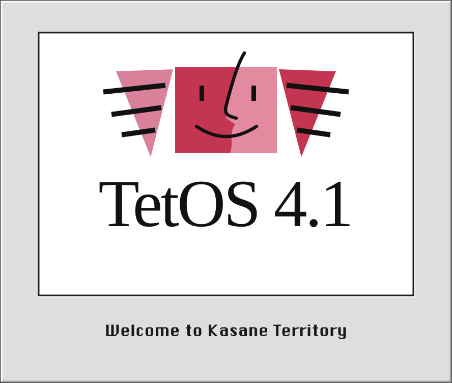
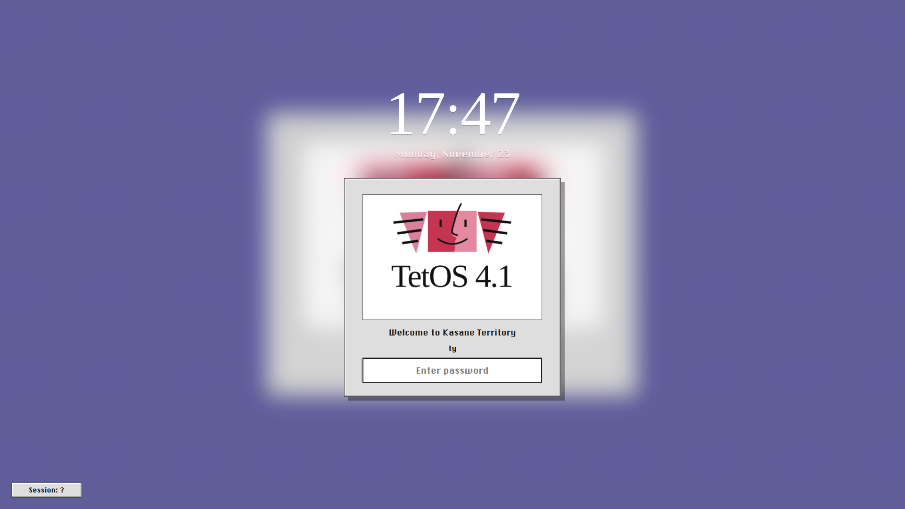

# TetOS 4.1 — *Welcome to Kasane Territory*

A Kasane Teto–themed setup for [Omarchy](https://omarchy.org) (Arch Linux + Hyprland). It's my complete desktop: configs, theme, login and lock screens, boot splash, scripts, package lists and two small apps I wrote. Everything needed to recreate it on another PC is here.



<p align="center">
  <br><sub>Splash after logging in</sub>
</p>
<p align="center">
  <br><sub>Login screen (SDDM)</sub>
</p>

## 👉 New to Linux? Start with **[GUIDE.md](GUIDE.md)**

It walks you through everything from making a USB stick to your first login, with no Linux knowledge assumed.

## Quick start

**Already on Omarchy:**

```bash
git clone https://github.com/Tyisvibing/TetOS-config.git ~/TetOS-config
cd ~/TetOS-config
./install.sh
```

**On another Arch-based distro** (Arch, EndeavourOS, CachyOS, Garuda, …: *experimental*, not Manjaro):

```bash
sudo pacman -S --needed git
git clone https://github.com/Tyisvibing/TetOS-config.git ~/TetOS-config
cd ~/TetOS-config
./bootstrap/omarchy-layer.sh     # adds Omarchy's desktop; leaves your boot loader alone
sudo reboot                      # log in to the "Omarchy (Hyprland uwsm)" session
cd ~/TetOS-config && ./install.sh
```

**Fresh PC:** install Omarchy from its ISO ([omarchy.org](https://omarchy.org)), then use the first block. GUIDE.md covers it step by step.

## What's in it

| Piece | What it does | Files |
|---|---|---|
| **TetOS theme** | Teto red `#c43552` / pink `#e48aa0` Omarchy theme, plus Teto wallpapers | `home/.config/omarchy/themes/tetos/` |
| **Login splash** | A retro "Welcome to Kasane Territory" box on every screen after login. Fades after 4 s, or click it | `home/.config/quickshell/tetos-splash/` |
| **Login screen** | SDDM theme: the same retro dialog with clock, date and a session picker | `sddm/` |
| **Lock screen** | A retro grey dialog with the TetOS logo, a serif clock and a ChicagoFLF date (plugin `ty.lock`, a copy of `omarchy.lock`) | `home/.config/omarchy/plugins/ty.lock/` |
| **Boot splash** | Plymouth theme: TetOS logo on purple with a Teto-red progress bar | `plymouth/` |
| **Wallpaper transitions** | Outline-draw / pixel "contagion" transitions on wallpaper change, ported from [pocket-dots](https://github.com/diegoMalagrida/pocket-dots) | `home/.config/quickshell/wallfx/`, `home/.local/bin/wallfx*` |
| **Window look** | 1 px gaps, 2 px square borders, frosted blur, pop-in "overshoot" animations | `home/.config/hypr/looknfeel.lua` |
| **Bar** | Glassy top bar with icon workspaces (custom-workspaces plugin by Jim Cruz, MIT), world clocks and weather | `home/.config/omarchy/shell.json`, `plugins/jcruz.custom-workspaces/` |
| **Branding** | TetOS wordmark in *About*, Teto ASCII-art screensaver | `home/.config/omarchy/branding/` |
| **fastfetch** | TetOS logo, boxed sections, weather and a Claude Code usage block | `home/.config/fastfetch/` |
| **Terminals** | kitty in Monaco with a Teto background image (off in Claude/agent windows); ghostty, foot and alacritty in DepartureMono | `home/.config/{kitty,ghostty,foot,alacritty}/` |
| **Keyboard mouse** | warpd: drive the pointer from the keyboard (normal / hint / grid modes) | `home/.config/warpd/`, `home/.local/bin/omarchy-menu-warpd-keybindings` |
| **Extra sessions** | Mango (Wayland, with a Quickshell bar) and IceWM (retro X11), both set up with the same keys and apps | `home/.config/mango/`, `home/.config/quickshell/mangobar/`, `home/.icewm/` |
| **Dual-boot helpers** | Restarts come back to the OS you were last in. `Super+Ctrl+Alt+]` reboots straight into Windows once | `system/` |
| **My apps** | knobs (config editor) and muse-tui (terminal music player); see [below](#my-apps) | `apps/` |
| **Bootstrap** | Experimental: adds Omarchy's desktop to another Arch-based distro | `bootstrap/` |

## The installer

`./install.sh` installs the essentials, then asks yes/no about each optional part. Flags skip the questions:

| Flag | Adds |
|---|---|
| *(none)* | Packages from `packages/required.txt` + `aur.txt`, all of `home/`, the FT Monogrid font, the TetOS theme |
| `--apps` | The rest of my apps (`packages/apps.txt`) |
| `--sessions` | Mango + IceWM (`packages/sessions.txt`) |
| `--build` | Builds and installs knobs and muse-tui |
| `--sddm` | The TetOS login screen (an SDDM drop-in, so Omarchy's own files stay untouched) |
| `--plymouth` | The TetOS boot splash. Real Omarchy only, since it rebuilds the initramfs |
| `--system` | Dual-boot helpers: `/usr/local/bin` scripts, a sudoers rule, `boot-order-linux-first.service` |
| `--wallfx` | The wallfx venv (~1 GB: rembg + onnxruntime + a model) for the outline-draw transition. Without it, every change uses the pixel transition |
| `--monitors` | `hypr/monitors.lua`. It's for **my** screens (ASUS XG248QSG 610 Hz plus an Acer KG272 rotated portrait), so only use it on the same hardware |
| `--all` | Everything above except `--monitors` |
| `--minimal` | Essentials only, no questions |
| `--no-packages` | Don't install packages, just copy config |

It backs up every file it overwrites to `~/.local/state/tetos-backup-<date>/`, rewrites paths with my home folder in them (`/home/ty/…`) to yours, and is safe to re-run.

## The bootstrap (other Arch-based distros)

Omarchy only installs from its own ISO, so `bootstrap/omarchy-layer.sh` adds Omarchy's desktop layer to an existing Arch-based install:

1. Full system update, then trusts Omarchy's signing key (`40DF B630 FF42 BCFF B047 046C F013 4EE6 80CA C571`) and adds `[omarchy]` to `/etc/pacman.conf` (original saved as `/etc/pacman.conf.pre-tetos`).
2. **Keeps your boot loader:** a tiny local package, `tetos-boot-shim`, stands in for Omarchy's Limine tools (`limine-mkinitcpio-hook`, `limine-snapper-sync`), and `NoExtract` blocks Omarchy's mkinitcpio/limine drop-ins. So GRUB, systemd-boot, rEFInd and your initramfs stay as they are.
3. Installs `omarchy` and its default package set.
4. **Keeps your distro's identity:** Omarchy's settings package rewrites `/etc/os-release` and `/etc/nsswitch.conf` on every update. A pacman hook puts your distro's versions back.
5. Runs only the parts of Omarchy's setup that don't touch boot, network or mirrors (lock-screen PAM, SDDM, Bluetooth, theme assets), copies `/etc/skel` into your home (with backups) and runs `omarchy-provision-user --first-install`.
6. Offers to switch your login manager to SDDM.

Not available after a bootstrap: Limine snapshot booting, the Plymouth splash and Omarchy's LUKS login. The script refuses Manjaro, needs x86_64 + systemd, and asks you to type `yes` after showing its plan. **Experimental:** the dependency shim, `NoExtract` and the os-release hook were tested in a throwaway pacman root against the live repos, but it hasn't been run end-to-end on every distro. Snapshot first.

## Keybindings added

Omarchy's own shortcuts all still work (**Super + K** lists everything). TetOS adds:

| Keys | Action |
|---|---|
| `Super + Ctrl + W` / `Super + Ctrl + Space` | Wallpaper switcher (with wallfx transition) |
| `Ctrl + =` / `Ctrl + -` | Volume up / down (keyboard without media keys; steals browser zoom) |
| `Super + Alt + M` / `H` / `U` | warpd keyboard mouse: normal / hint / grid. `Super + Shift + Alt + K` lists its keys |
| `Super + Alt + A` | Claude Code in kitty |
| `Super + Shift + D` | Discord |
| `Super + Shift + M` | Muse music player |
| `Super + Alt + O` | Opera |
| `Super + Ctrl + C` | VS Code |
| `Super + Alt + P` | Pulsar (snap) |
| `Ctrl + Shift + Esc` | Mission Center (task manager) |
| `Super + Ctrl + Alt + ]` | Restart to Windows (needs `--system`) |
| `Super + Ctrl + Alt + I` | Switch to the IceWM session (needs `--system` and `--sessions`) |

The Omarchy menu also gets **System → Restart to Windows**, and its **Background** item goes through wallfx.

## My apps

Built with `./install.sh --build` (or by hand, see each README):

- **[knobs](apps/knobs/README.md)**: opens any config file as a settings menu, with each option explained from the program's own documentation. Qt/QML, installed as an Arch package. The explanations use [Claude Code](https://claude.com/claude-code) if it's installed.
- **[muse-tui](apps/muse-tui/README.md)**: a terminal music player with an FFT visualizer, for the library of my Muse player (`~/.config/muse-player/library.db`). Muse itself isn't in this repo, so muse-tui needs a Muse library to play from.

## Things to change for your machine

- **Weather** in fastfetch: `~/.config/fastfetch/config.jsonc` → `"location"`. Use `+` instead of spaces (`New+York`), because fastfetch doesn't URL-encode it.
- **World clocks** in the bar: `~/.config/omarchy/shell.json` → `omarchy.elsewhen` → `cities`.
- **Dock apps**: `shell.json` → `dock.pinned`.
- **Launchers** for Muse / Pulsar / Claude in `~/.config/hypr/bindings.lua` assume they're installed where mine are.

## Dual-boot notes (`--system`)

- `boot-order-linux-first.service` puts the Linux boot entry you started from first in the UEFI BootOrder at every Linux boot, so a plain restart comes back to Linux. It works with Limine, GRUB, systemd-boot or rEFInd.
- `reboot-to-windows` → `sudo boot-windows-next` sets a one-shot UEFI `BootNext` to Windows Boot Manager, then reboots.
- **Windows side** (not in this repo): you need a matching startup task that puts Windows Boot Manager first while you're in Windows, plus a "Restart to Linux" shortcut (`bcdedit /set {fwbootmgr} bootsequence {<linux-entry-guid>}`). Without it, restarts from Windows still go to Linux.

## Reverting

```bash
omarchy theme set <another-theme>
omarchy refresh shell                               # stock bar + lock screen (backs up first)
sudo ./sddm/install.sh --revert                     # login screen
sudo plymouth-set-default-theme -R omarchy          # boot splash
sudo systemctl disable boot-order-linux-first       # dual-boot service
```

Old files are in `~/.local/state/tetos-backup-<date>/`. Undoing the bootstrap is covered in [GUIDE.md § 11](GUIDE.md#11-undoing-things).

## Repo layout

```
GUIDE.md         beginner step-by-step install guide
install.sh       TetOS installer (run on Omarchy)
bootstrap/       omarchy-layer.sh (experimental, other Arch distros) + Omarchy's public signing key
home/            copied into $HOME as-is
  .config/       hypr, omarchy (theme, plugins, bar, hooks), quickshell (splash, wallfx, mangobar),
                 fastfetch, kitty, ghostty, foot, alacritty, mango, warpd, cava, starship.toml
  .icewm/        IceWM session config
  .local/bin/    wallfx, wallfx-bg-set, wallfx-bg-next, reboot-to-windows, retro-switch,
                 omarchy-menu-warpd-keybindings
sddm/            TetOS login-screen theme + installer
plymouth/        TetOS boot-splash theme + installer
system/          /usr/local/bin helpers, systemd unit, sudoers template (--system)
packages/        required.txt, aur.txt, sessions.txt, apps.txt
apps/            knobs and muse-tui source
fonts/           FT Monogrid (installed by install.sh)
```

## Credits

- Kasane Teto © TWINDRILL. The wallpapers and art here are fan material; they're credited to their artists and not covered by this repo.
- Wallpaper transitions: [pocket-dots](https://github.com/diegoMalagrida/pocket-dots) (license in `home/.config/quickshell/wallfx/LICENSE`).
- Custom Workspaces bar plugin: Jim Cruz (MIT).
- FT Monogrid font: freeware, non-commercial ([fontspace](https://www.fontspace.com/ft-monogrid-font-f163310)).
- Built on [Omarchy](https://omarchy.org). TetOS isn't affiliated with Omarchy or Basecamp.
