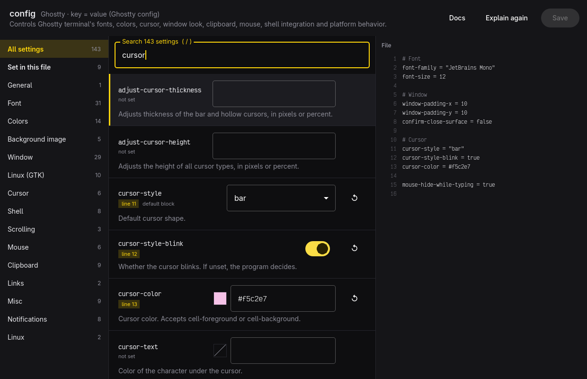

# knobs



Config files are hard to edit as plain text and hard to understand without the
docs. knobs opens any config file, has Claude find the documentation for the
program that reads it (man pages, `/usr/share/doc`, the package's own examples,
the official website), and turns it into a settings menu: **every** option the
program supports, explained, with the right control for its type: switches,
choice menus, numbers, color swatches. The ones your file already sets are
marked with their line.

Edits touch only the line they change. A setting the file doesn't have yet is
added inside the section it belongs to; removing one deletes its line so the
program's default applies. The file pane on the right shows exactly what will
be saved.

## Use

```sh
knobs                         # start screen: recent and common configs
knobs ~/.config/ghostty/config
```

The first time you open a file, Claude reads the docs. That takes a minute or
two for a big program and uses your Claude Code login. The explanation is cached
per file, so opening the file again is instant and free. If the file changes
elsewhere, knobs finds its settings again in the new text and offers to explain
it afresh (**R**).

knobs needs [Claude Code](https://claude.com/claude-code) (`claude`) installed
and signed in. Claude only gets read-only tools: it can look things up, but it
can't change files. The file's contents are sent to Claude as part of the
request, so don't open files that hold secrets.

| Key | Action |
| --- | --- |
| `Ctrl+O` | Open a config file |
| `/` | Search settings (across every section) |
| `↑` `↓` | Move between settings |
| `Enter` / `Space` | Change the current setting |
| `Delete` | Remove it from the file, so the default applies |
| `Esc` | Leave a field, clear the search, or stop reading the docs |
| `Ctrl+S` | Save |
| `Ctrl+Z` / `Ctrl+Shift+Z` | Undo / redo |
| `R` | Read the documentation again |
| `S` | Show or hide the file |
| `Ctrl+W` | Close the file |
| `?` | Show every shortcut |
| `Q` | Quit (asks first if there are unsaved changes) |

### Safety

- Nothing is written until you save.
- Saves are atomic (written beside the file, then renamed) and follow symlinks.
- The first save of each session keeps the original in
  `~/.local/state/knobs/backups/`.
- If another program changed the file while you had it open, knobs refuses to
  overwrite it.
- Values are checked against the option's type, range, and choices before they
  are written.

## Command line

Every command takes `--json`, exits 0 or 1, and prints errors on stderr.

```sh
knobs explain <file> [--refresh]     # every setting, explained
knobs get <file> <key>               # one setting's value
knobs set <file> <key> <value>       # change a setting and save
knobs unset <file> <key>             # remove a setting's line and save
knobs skill install                  # teach Claude Code to use knobs
```

`KNOBS_MODEL` picks the Claude model (default `sonnet`), and `KNOBS_CLAUDE`
points at a different `claude` binary.

## Build

```sh
bin/build      # build/knobs
bin/test       # Qt Test suite, offscreen
bin/install    # makepkg -fsi: installs the binary, launcher entry, and icon
```

C++17 and Qt 6 Quick, built with qmake. knobs follows the Omarchy theme accent,
Hyprland's window rounding, and the language picked under Setup > Language
(English, Danish, German, and Spanish so far). Explanations are written in that
language too.
